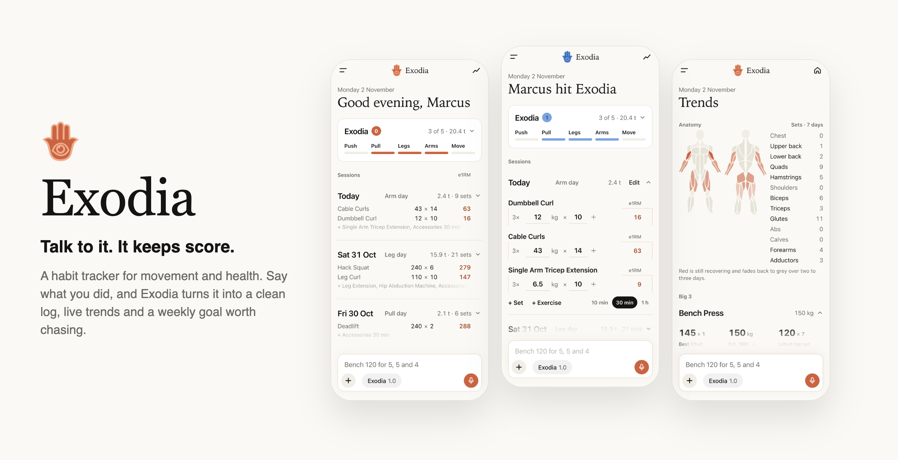
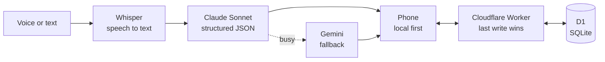

<p align="center"></p>

<p align="center">
  <b>A habit tracker for movement and health.</b><br>
  Say what you did. Exodia turns it into a clean log, live trends and a weekly goal worth chasing.
</p>

<p align="center">
  <a href="https://exodia.marcusokodugha.workers.dev/join"><b>Try it</b></a> ·
  <a href="#how-it-works">How it works</a> ·
  <a href="#under-the-hood">Under the hood</a> ·
  <a href="#where-its-going">Where it's going</a>
</p>

---

## Why

Most tracking apps make you work for them: menus inside menus, forms, pickers, a tap for every number. People stop logging, and the habit dies with the log.

Exodia goes the other way. Everything lives on one page, you log by talking, and the app does the bookkeeping. Training is the first habit it tracks. Cardio, movement, recovery and mind come next.

## How it works

### 1. Talk, type or drop a file


Hold the mic and ramble the way you would to a training partner:

> "Arm day. Two sets of 12 kg curls, then cable curls 43 for three sets of 14, single arm tricep extension 6.5 for three sets."

Exodia transcribes it, understands it and puts every set on the right day. It handles corrections ("70, no, 100"), reps in reserve, warm-ups, "last Friday" and moving things between days. Anything it isn't sure about, it asks instead of guessing.

Prefer tapping? Quick add keeps your most used lifts one tap away, with Bench, Squat and Deadlift always on top. Coming from another app? Drop in a StrengthLog or Strong export, a spreadsheet or plain notes, and your history is sorted into days in seconds.

<br clear="right">

### 2. One page, everything in view


Every day is one row you can open. Closed, it shows the top set of each lift and its estimated one-rep max (e1RM). Open, it shows every set, the percentage of your best and the e1RM. Identical sets collapse into one line (`3×`), so a day stays short.

Real PRs get a filled pill. A new estimated max gets an outlined one. A lift needs history before it can set a record, so a first-time lift never shows a fake PR.

Every change can be undone, and every command, spoken or typed, is kept in a log.

<br clear="left">

### 3. Hit Exodia


Like the card game legend, Exodia has five pieces. Collect all five within a rolling seven days:

| Piece | What counts |
| --- | --- |
| **Push** | A heavy press, twice. Heavy means a top set at 85% or more of your best e1RM. |
| **Pull** | A heavy deadlift |
| **Legs** | Any real leg work |
| **Arms** | Arm work |
| **Move** | Cardio or a walk of 20 minutes or more, twice |

The five bars fill as you train. When the last one lands, the bars lift off the card and become the fingers of the hand, the counter becomes the eye, and the hand turns blue and drops into the logo. It stays blue until a piece falls out of the week.

<br clear="right">

### 4. See what you've trained


Trends opens on an anatomy map. Muscles you trained turn red and fade back to grey as they recover over two to three days. Next to it are your sets per muscle for the week.

Below that, every lift has its best lifted set, its estimated max and a monthly trend line. Tap any lift anywhere in the app to jump straight to its trend.

<br clear="left">

### 5. Bring a friend


There's no sign-up and no password. A new person types a name, optionally pastes their history, and starts logging. A private link moves their data to a second device. Friends get their own blue version of the app at [`/join`](https://exodia.marcusokodugha.workers.dev/join).

<br clear="right">

## Under the hood



- **No framework.** The front end is one hand-written JavaScript file and one stylesheet, installed as a home-screen web app. It loads instantly and works offline through a service worker.
- **Local first.** Every change is saved on the phone right away and synced in the background to Cloudflare D1, with per-day timestamps so two devices never overwrite each other.
- **Voice that holds up in a gym.** Whisper on Workers AI transcribes with a gym vocabulary, and the phone's own transcript goes along as a hint. Claude Sonnet turns the words into strict, schema-checked JSON. If the model is busy, it retries and falls back to Gemini, so a log is never lost.
- **AI as a tool.** An endpoint lets an assistant add training from a chat, and a dry-run mode lets the AI read text without writing anything.
- **Built for the hand it's held in.** Phone first and touch only, with swipe to delete and long press to edit. iOS web apps can't lock rotation, so the interface turns itself back upright when the phone is held sideways.
- **Calm by design.** Few colors, no boxes around everything, and numbers that line up in columns across every row. Motion is limited to transforms and opacity, so animations stay smooth on a phone.
- **A built-in lab.** A hidden developer menu replays the Exodia animation and runs a full new-user test in a sandbox that saves nothing.

| Layer | Tech |
| --- | --- |
| App | Vanilla JS, CSS, service worker, Web Audio |
| Server | Cloudflare Workers, static assets, rate limiting |
| Data | Cloudflare D1 (SQLite) |
| AI | Workers AI Whisper, Claude Sonnet via the Anthropic SDK, Gemini fallback |

## Where it's going

Exodia is a habit tracker that happens to start with the gym. Next up:

- **Movement:** steps, walks, runs and rides, with Move filling up from them.
- **Recovery:** sleep and rest days that count toward the week.
- **Mind:** focus, reading and meditation as pieces of their own.
- **Your own Exodia:** pick the five pieces that matter to you.

## Run it locally

```bash
npm install
npx wrangler d1 migrations apply exodia --local
npx wrangler dev
```

The app runs at `http://localhost:8787`. Voice and AI need `ANTHROPIC_API_KEY` or `GEMINI_API_KEY` set as Worker secrets.

---

<p align="center">Built by <a href="https://github.com/MarcusOkodugha">Marcus Okodugha</a>.</p>
