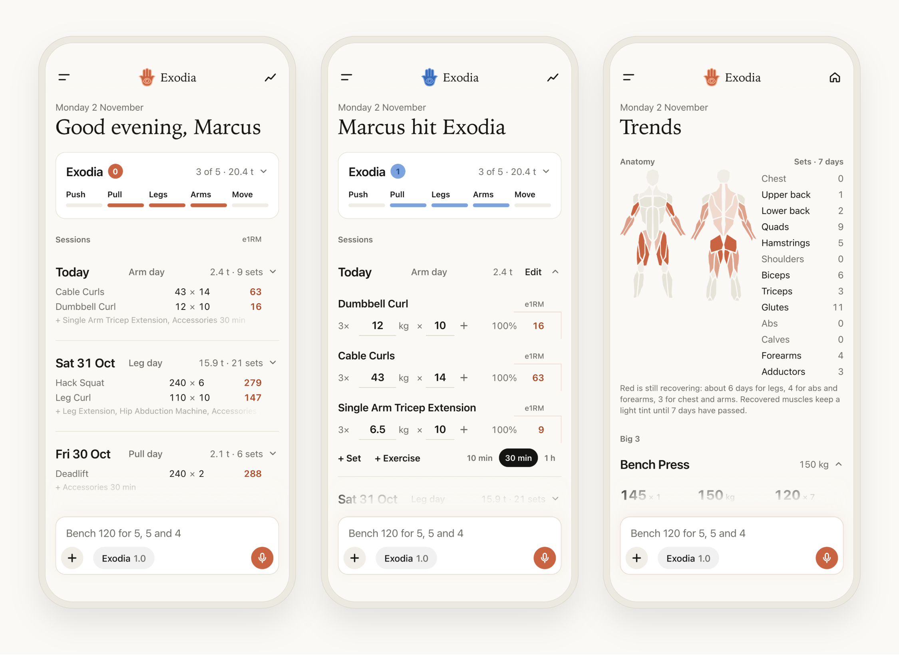
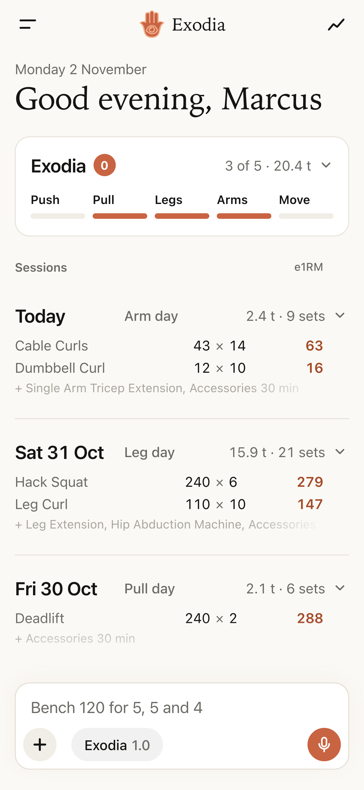
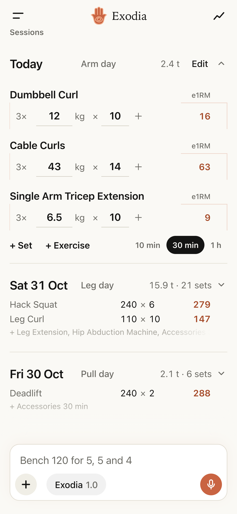
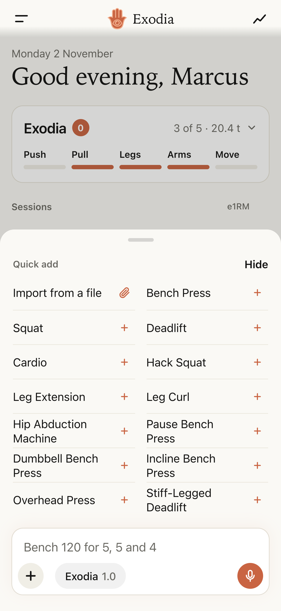
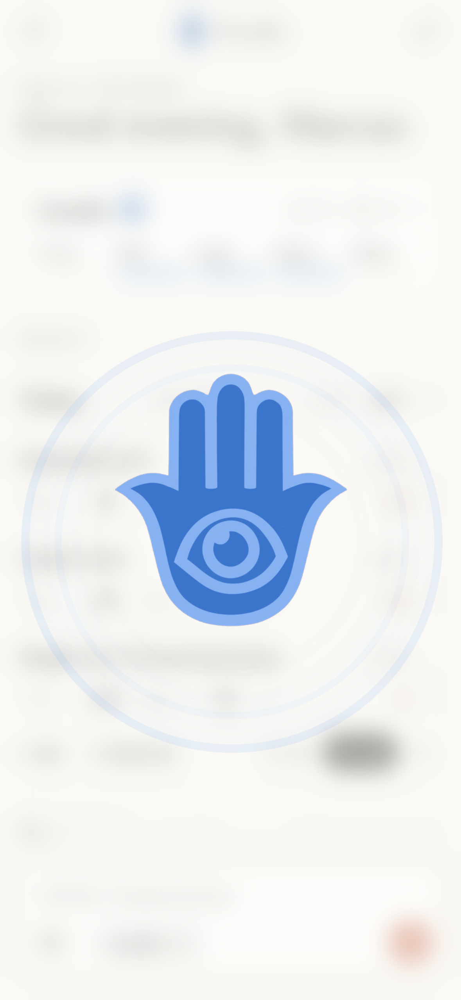
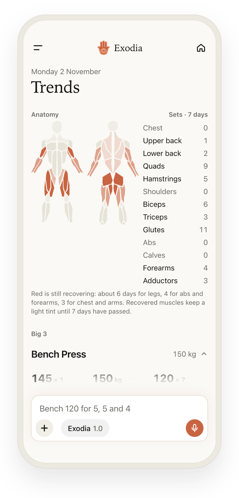
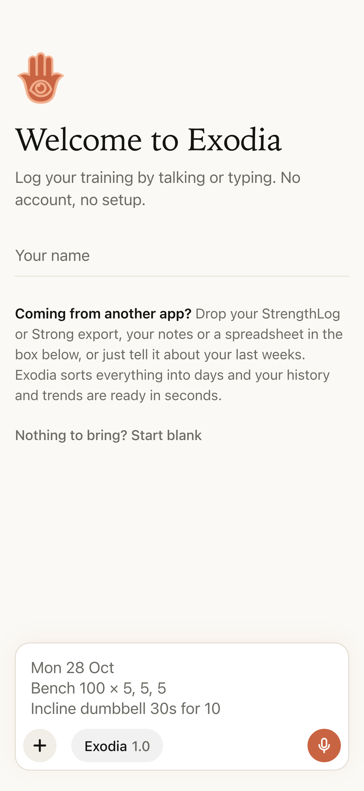
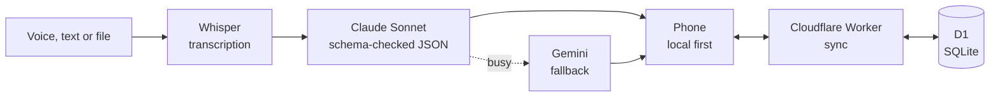

<p align="center"></p>

<h1 align="center">Exodia</h1>

<p align="center">
  <b>Unstructured in. Structured out.</b><br>
  Talk, type or paste anything. Exodia transcribes it, turns it into structured data and tracks it for you.
</p>

<p align="center">
  <a href="https://exodia.marcusokodugha.workers.dev/join"></a>
</p>

<h3 align="center"><a href="https://exodia.marcusokodugha.workers.dev/join">exodia.marcusokodugha.workers.dev/join</a></h3>

<p align="center">No sign-up. Open it on your phone and add it to the Home Screen.</p>

---

## What it does

- **Transcribes** voice notes with Whisper, tuned to a gym's vocabulary.
- **Structures** rambling speech, chat messages and old exports (StrengthLog, Strong, spreadsheets) into validated JSON with Claude.
- **Tracks** every entry on one page, with undo and a full command log.
- **Analyses** progress: estimated one-rep max, personal records, monthly trends and a muscle recovery map.
- **Motivates** with Exodia, a weekly goal of five pieces you collect in a rolling seven days.

## Unstructured to structured

You say:

> "Arm day. Two sets of 12 kg curls for 10, then cable curls 43 for three sets of 14."

Exodia stores:

```json
{
  "date": "2026-11-02",
  "label": "Arm day",
  "exercises": [
    { "name": "Dumbbell Curl", "sets": [{ "kg": 12, "reps": 10 }, { "kg": 12, "reps": 10 }] },
    { "name": "Cable Curls", "sets": [{ "kg": 43, "reps": 14 }, { "kg": 43, "reps": 14 }, { "kg": 43, "reps": 14 }] }
  ]
}
```

It handles corrections ("70, no, 100"), relative dates ("last Friday"), reps in reserve, warm-ups and moving entries between days. When something is unclear, it asks instead of guessing.

## Screens

<table>
  <tr>
    <td align="center" width="33%"><br><b>Home</b><br>Every day on one page</td>
    <td align="center" width="33%"><br><b>Day</b><br>Sets, % of best and e1RM</td>
    <td align="center" width="33%"><br><b>Quick add</b><br>One tap, or import a file</td>
  </tr>
  <tr>
    <td align="center"><br><b>Exodia</b><br>All five pieces in a week</td>
    <td align="center"><br><b>Trends</b><br>Recovery map and progress</td>
    <td align="center"><br><b>Start</b><br>Name, paste your history, go</td>
  </tr>
</table>

## Exodia, the weekly goal

Five pieces, collected within any seven days. Fill all five and the hand assembles, the bars and logo turn blue, and they stay blue until a piece drops out of the week.

| Push | Pull | Legs | Arms | Move |
| --- | --- | --- | --- | --- |
| Heavy press, twice | Heavy deadlift | Leg work | Arm work | 20 min cardio or walk, twice |

## Under the hood



- **No framework.** One JavaScript file and one stylesheet, installed as a home-screen web app that works offline.
- **Local first.** Saved on the phone instantly, synced in the background with per-day timestamps so devices never overwrite each other.
- **Resilient AI.** Whisper on Workers AI for speech, Claude for structure, automatic retry and Gemini fallback, and a dry-run mode that writes nothing.
- **No accounts.** A private device key instead of a password, and a personal link to add a second device.
- **Built for phones.** Touch first, swipe to delete, long press to edit, and an interface that stays upright when the phone is turned.

| Layer | Tech |
| --- | --- |
| App | Vanilla JS, CSS, service worker |
| Server | Cloudflare Workers, rate limiting |
| Data | Cloudflare D1 (SQLite) |
| AI | Workers AI Whisper, Claude Sonnet (Anthropic SDK), Gemini fallback |

## Where it's going

Training is the first thing Exodia tracks, not the last.

- **Movement:** steps, runs and rides.
- **Recovery:** sleep and rest days.
- **Mind:** focus, reading and meditation.
- **Your own Exodia:** choose the five pieces that matter to you.

## Run it locally

```bash
npm install
npx wrangler d1 migrations apply exodia --local
npx wrangler dev
```

Open `http://localhost:8787`. Voice and AI need `ANTHROPIC_API_KEY` or `GEMINI_API_KEY` set as Worker secrets.

---

<p align="center">Built by <a href="https://github.com/MarcusOkodugha">Marcus Okodugha</a> · <a href="https://exodia.marcusokodugha.workers.dev/join">Try Exodia</a></p>
